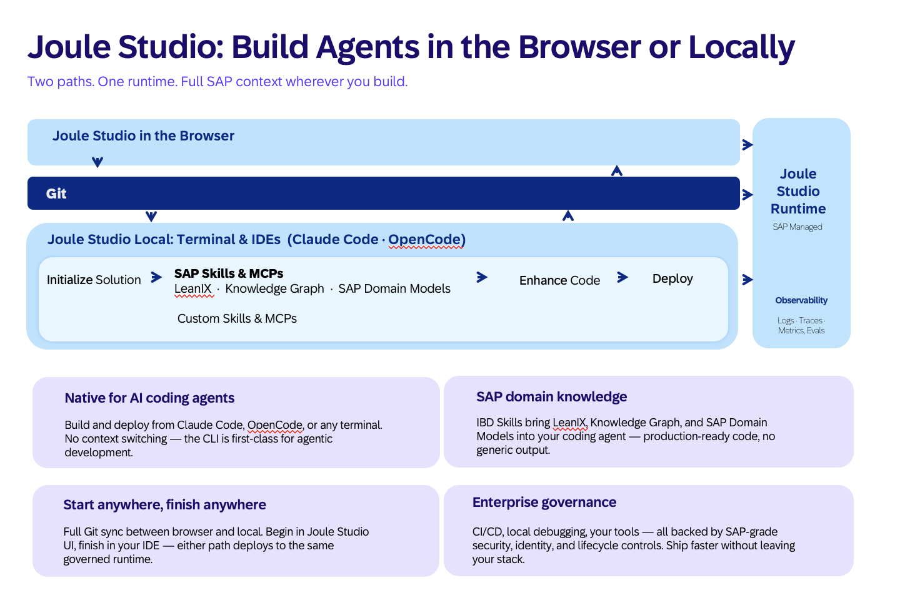

# AD263 — Build a Supplier Disruption Response Agent on SAP S/4HANA

[](https://api.reuse.software/info/github.com/SAP-samples/teched2026-AD263)

## Description

This repository contains the hands-on exercise materials for **session AD263** at SAP TechEd 2026.

### What is Joule Studio?

**Joule Studio** is SAP's platform for building, deploying, and managing AI agents. It provides an end-to-end development experience — from describing what you want in plain language to running a production agent in SAP AI Core, accessible via SAP Joule.

Joule Studio supports two development modes:

| Mode               | Who it's for                  | How it works                                                     |
| ------------------ | ----------------------------- | ---------------------------------------------------------------- |
| Web                | Developers, business analysts | Visual flow builder in a browser                                 |
| **Local / CLI**    | Developers, technical PMs     | `jl` CLI + coding agent (Claude Code or opencode) on your laptop |



In this session you use the **local / CLI** path. The core mechanic is **Intent-Based Development (IBD)**: you describe the agent's goal in plain language, and Joule Studio's IBD engine generates a PRD, a technical specification, and a full implementation — which you then review, extend, and deploy.

The `jl` CLI is the entry point for the pro-code flow:

```
jl login          # authenticate against your AI Core instance
jl init claude    # scaffold the project + wire the IBD MCP server
```

Once initialised, a coding agent (Claude Code or Opencode) runs inside your terminal and drives the IBD flow through natural-language instructions.

---

In this session you will build a production-grade AI agent from scratch using the **Joule Studio Local / CLI flow**. The agent connects to SAP S/4HANA Public Cloud and automates the end-to-end response to a supplier disruption event: from identifying at-risk purchase orders and scheduling agreements to delivering a risk-scored, fully labeled assessment report.

---

## Scenario

You are a **Procurement Manager** at a mid-sized manufacturer. A key supplier has just announced a production halt due to a logistics disruption. You have open purchase orders and scheduling agreements in SAP S/4HANA — but coordinating a triage response manually takes hours.

By the end of this session your agent will:

1. Accept a disruption signal (event type, country, date)
2. Retrieve all at-risk open POs and scheduling agreement lines from SAP S/4HANA
3. Score each item HIGH / MEDIUM / LOW using a composite risk model
4. Present a fully labeled assessment — every claim tagged `[Confirmed Fact]`, `[Assumption]`, or `[Recommendation]`

```
┌─────────────────────────────────────────────────────────────────────────┐
│               Supplier Disruption Response Agent                        │
│                    LangGraph · SAP AI Core                              │
└──────────────────────────┬──────────────────────────────────────────────┘
                           │
      ┌────────────────────▼────────────────────┐
      │  M1 — Signal Detection & Classification  │
      └────────────────────┬────────────────────┘
                           │
      ┌────────────────────▼────────────────────┐
      │       M2 — SAP Data Retrieval            │◄── S/4HANA: Purchase Orders
      │                                          │◄── S/4HANA: Scheduling Agreements
      └────────────────────┬────────────────────┘
                           │
      ┌────────────────────▼────────────────────┐
      │    M3 — Impact & Risk Assessment         │
      │    HIGH / MEDIUM / LOW per line item     │
      └────────────────────┬────────────────────┘
                           │
      ┌────────────────────▼────────────────────┐
      │   M4 — Consolidated Risk Report          │
      │   Labeled exposure summary presented     │
      │   to procurement manager                 │
      └─────────────────────────────────────────┘

  Every output: [Confirmed Fact] | [Assumption] | [Recommendation]
```

---

## Business Outcomes

| Metric                        | Current (manual) | Target (agent)  |
| ----------------------------- | ---------------- | --------------- |
| Time to identify at-risk POs  | Hours            | < 15 minutes    |
| Full risk-scored triage done  | Hours            | < 30 minutes    |
| Recommendation traceability   | Ad hoc           | 100% labeled    |

---

## System Architecture

| MCP Server                                | SAP System               | API                          | Type |
| ----------------------------------------- | ------------------------ | ---------------------------- | ---- |
| `sap-s4-purchase-order-mcp-server`        | SAP S/4HANA Public Cloud | `CE_PURCHASEORDER_0001`      | Read |
| `sap-s4-scheduling-agreements-mcp-server` | SAP S/4HANA Public Cloud | `API_SCHED_AGRMT_PROCESS_SRV` | Read |

Both MCP servers are generated during the exercise using the MCP Builder in Joule Studio.

> [!note] Tenant API registration
> Only `CE_PURCHASEORDER_0001` and `API_SCHED_AGRMT_PROCESS_SRV` are registered on the workshop tenant. If IBD proposes additional APIs (Preferred Supplier List, Business Partner, or any Ariba API), they are not available in this environment and must be removed before deployment. Exercise 2 shows you how to catch this.

---

## Requirements

### Technical Prerequisites

- VS Code installed on your session laptop
- `jl` CLI (Joule Studio CLI) — verified in [Exercise 0](exercises/ex00/README.md)
- Credentials for the provided Joule Studio landscape (handed out by the session guide)

### No starter repo needed

You create everything from scratch using the IBD (Intent-Based Development) flow. There is nothing to clone before.

---

## Exercises

| Exercise | Title | Duration |
|----------|-------|----------|
| [Exercise 0](exercises/ex00/README.md) | Set Up Your Environment | ~10 min |
| [Exercise 1](exercises/ex01/README.md) | Enter Your Intent | ~10 min |
| [Exercise 2](exercises/ex02/README.md) | Review Intent, PRD & Specification | ~15 min |
| [Exercise 3](exercises/ex03/README.md) | Implementation & Code Review | ~30 min |
| [Exercise 4](exercises/ex04/README.md) | Deploy & Test Your Agent | ~15 min |
| [Exercise 5](exercises/ex05/README.md) | Bonus Exercises | remaining time |

Start with [Exercise 0 →](exercises/ex00/README.md)

---

## Learning Objectives

After completing this session you will be able to:

1. Use the Joule Studio **local / CLI** IBD flow end-to-end: Intent → PRD → Specification → Implementation
2. Discover SAP APIs via the SAP Knowledge Graph and generate MCP servers from OpenAPI and EDMX specs
3. Build a multi-API AI agent on SAP S/4HANA Public Cloud from scratch
4. Implement risk scoring and output labeling as production-grade agent guardrails
5. Deploy and test an AI agent via the Joule Studio CLI (`jl`) and interact with it through SAP Joule

---

## How to obtain support

This repository is provided as-is for the SAP TechEd 2026 hands-on session. For questions during the session, raise your hand — a session guide is available.

---

## License

Copyright 2026 SAP SE or an SAP affiliate company. All rights reserved.
This project is licensed under the Apache Software License, version 2.0 — see [LICENSE](LICENSE) for details.
