# Exercise 0 — Set Up Your Environment

In this exercise you will open VS Code, create your working folder, log into the provided Joule Studio landscape, and launch the coding agent. This takes about 10 minutes.

> **Note — Coding agent**
> Depending on the landscape provided, the coding agent will be **Claude Code** (`claude`) or **opencode** (`opencode`). Both support the same IBD flow — every step in these exercises is identical regardless of which one is installed.

---

## Step 0.1 — Open VS Code

1. Click **Visual Studio Code** on the desktop (or taskbar)
2. If a "Sign in" or welcome page opens, close it

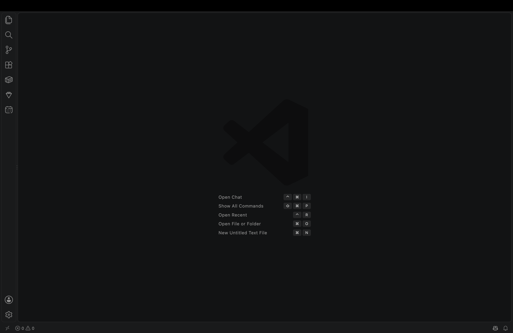

> **Note**
> VS Code is used as the primary IDE for this session. Any other IDE or a plain terminal works equally well with Joule Studio CLI.

## Step 0.2 — Create Your Working Folder

1. In VS Code, open the Explorer panel on the left sidebar (folder icon, or `Ctrl+Shift+E` on Windows · `Cmd+Shift+E` on Mac)
2. Click **Open Folder**
3. Navigate to your **Desktop**
4. Create a new folder named `<your-project-name>` (e.g. `supplier-agent-<name>`)
5. Select the folder and click **Open**

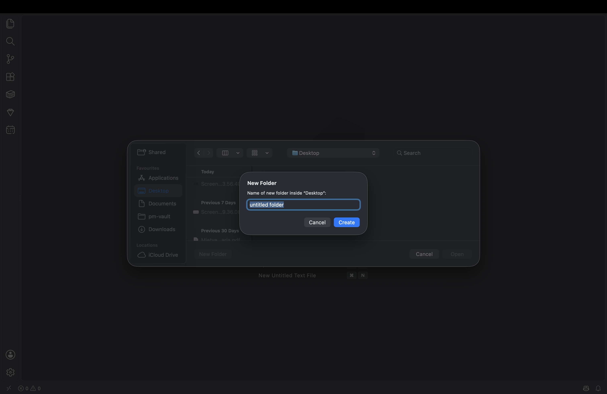

You should now see an empty Explorer panel with the folder name at the top left.

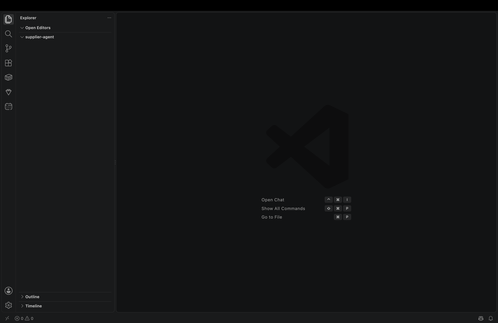

> **💡 Tip**
> If VS Code asks "Do you trust the authors of the files in this folder?" — click **Yes, I trust the authors**.

## Step 0.3 — Open a Terminal

1. In VS Code, open a terminal:
   - Menu: `…` → **Terminal** → **New Terminal**
   - Shortcut: `` Ctrl+` `` on Windows/Linux · `` Cmd+` `` on Mac
2. A terminal panel opens at the bottom of VS Code. Confirm it shows your project folder as the current directory.

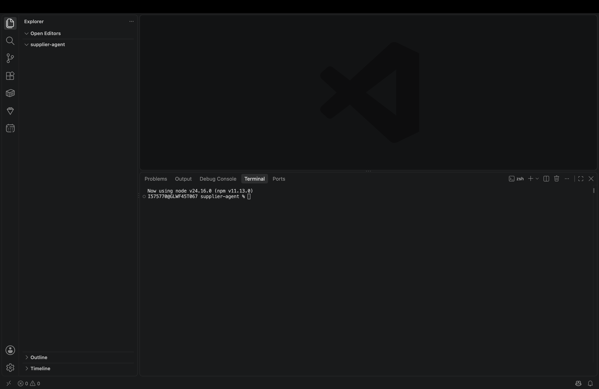

## Step 0.4 — Verify the CLI

Run:

```bash
jl --help
```

You should see the full list of available Joule Studio CLI commands.

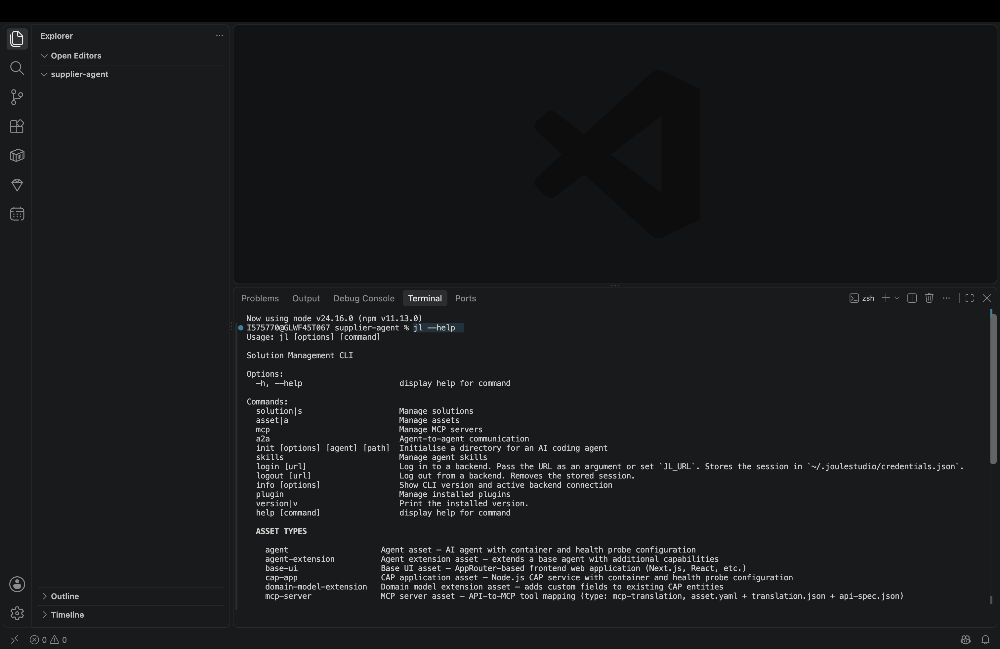

Then check the installed version:

```bash
jl version
```

or shorthand:

```bash
jl v
```

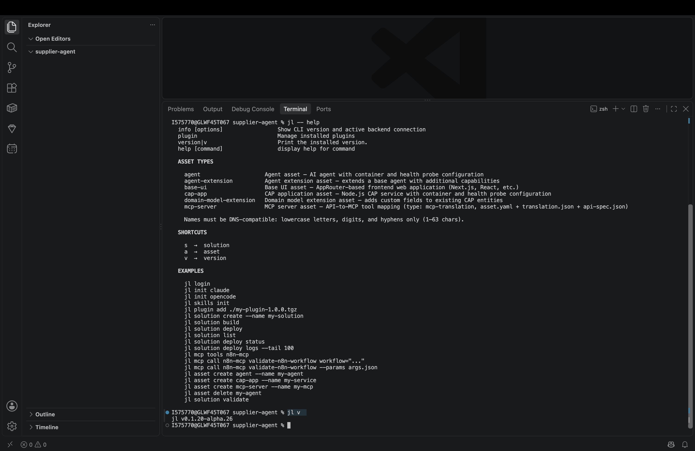

## Step 0.5 — Log In

The `jl` CLI authenticates against your **Joule Studio** instance. Before running `jl login`, get your personal Sign-in URL from the Joule Studio web UI:

1. Open Joule Studio in your browser


2. Select your user icon in the bottom-left corner → **Settings**

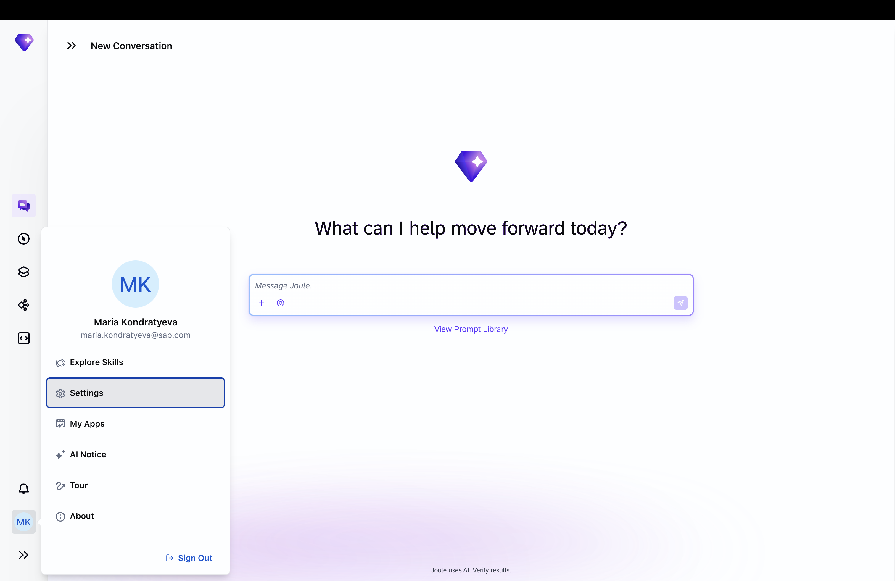

3. Go to **Develop**
4. Under **CLI Authorization**, copy the Sign-in URL — click the copy icon on the right

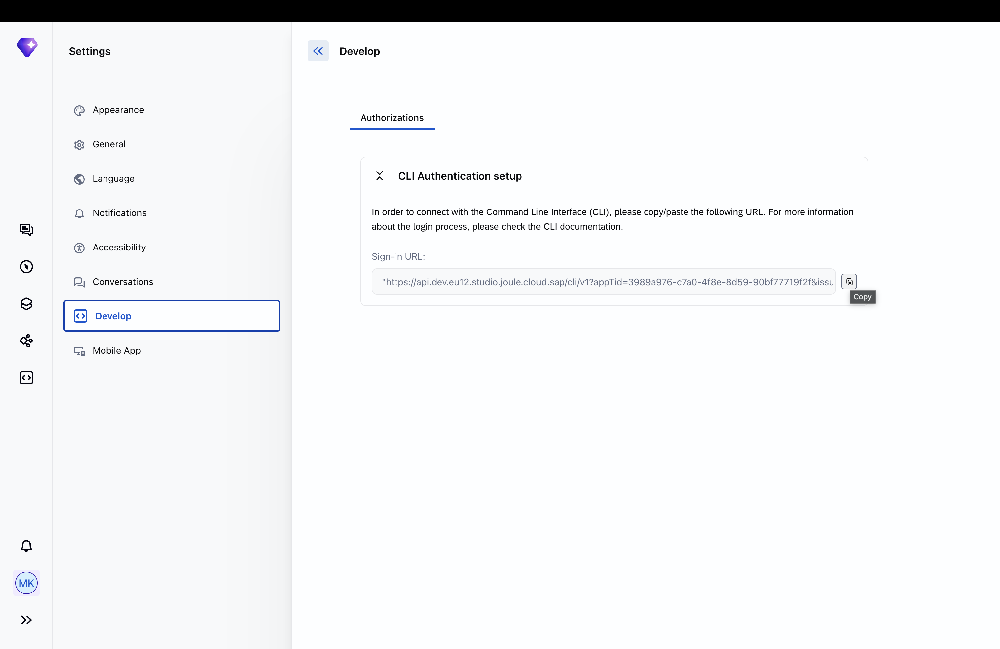

Comeback to the CLI and Pass the URL to `jl login` — wrap it in single quotes so the shell does not split it at the `&` characters:

```bash
jl login '<your Sign-in URL>'
```

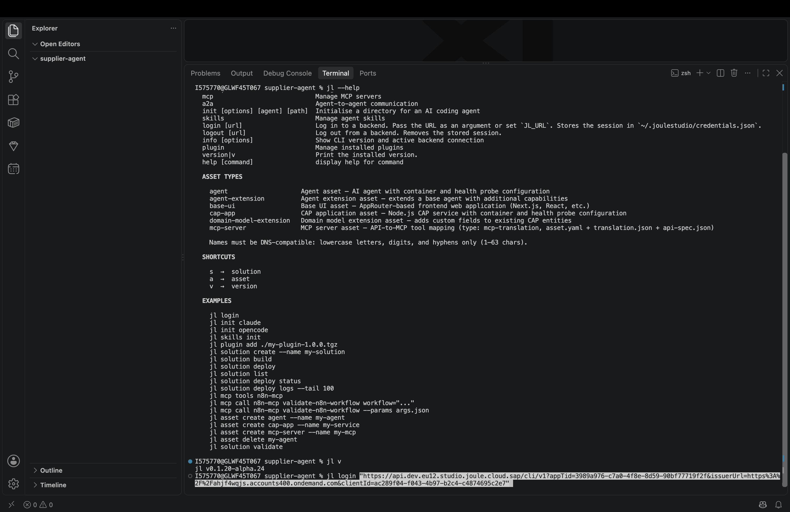

A browser window opens for you to authenticate. Once you confirm, the CLI stores the session and you can close the browser tab.

> **💡 Tip**
> After the first successful login, running `jl login` without an argument reuses the stored URL.

> **⚠️ Login expired?**
> If you see `401 Unauthorized` at any later step, open a new terminal tab and run `jl login` again before retrying.

## Step 0.6 — Initialize the Project

```bash
jl init claude
```

`jl init` sets up the Joule Studio project in your current folder: it fetches the IBD skills into `.claude/skills/` and writes `.mcp.json` and `.claude/settings.local.json`. After it completes you will see a `.claude/` config directory in your Explorer panel.

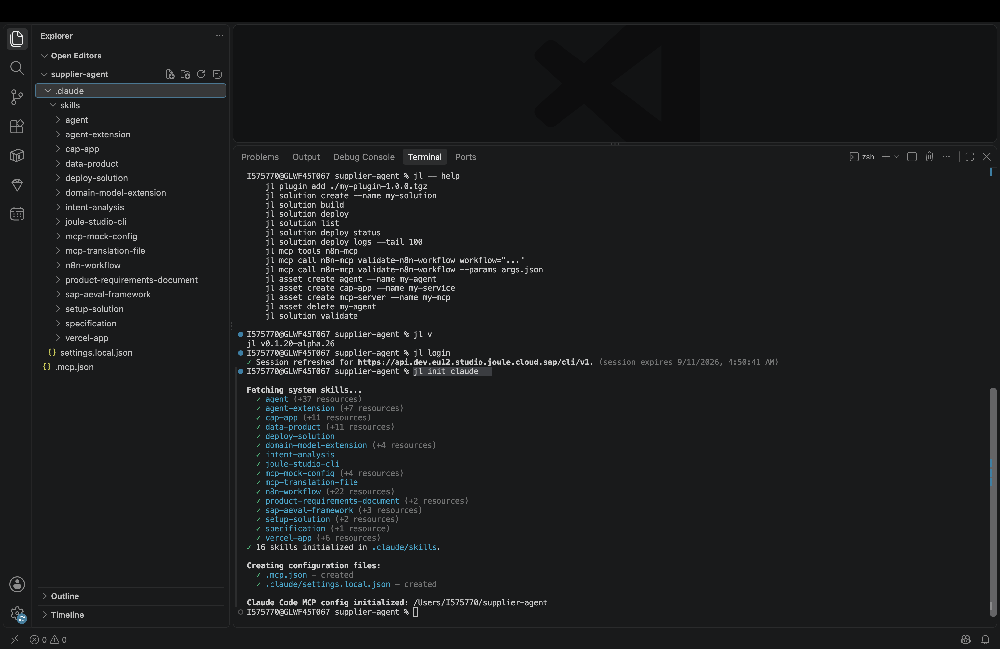

> **⚠️ Do not modify the IBD skills**
> The files fetched into `.claude/skills/` encode the conventions the generated solution needs for deployment. Do not edit them. Customise your agent through its own code, instructions, and tools — not through the skills that generate it.

## Step 0.7 — Launch the Coding Agent

```bash
claude
```

or:

```bash
opencode
```

The coding agent opens. You will see a chat interface inside the terminal.

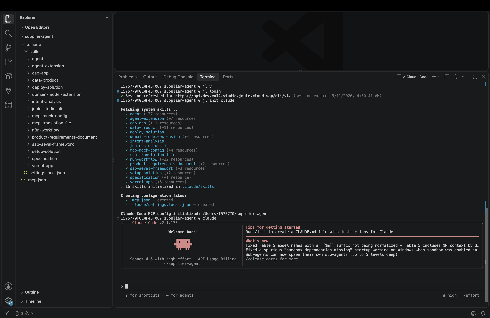

> **💡 Auto-approve mode**
> To skip per-action confirmation prompts during the exercise:
> - **Claude Code**: press `Shift+Tab` once or twice to cycle to **Auto-approve** mode (shown in the status line)
> - **opencode**: append `--auto` when launching: `opencode --auto`

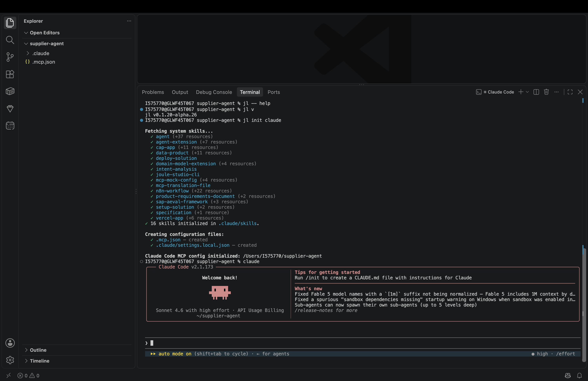


---

## Summary

After this exercise your setup looks like this:

```
Desktop/
└── <your-project-name>/
    └── .claude/          ← IBD skills + MCP config, created by jl init
```

The coding agent is running and waiting for input.

**Next step →** [Exercise 1 — Enter Your Intent](../ex01/README.md)
