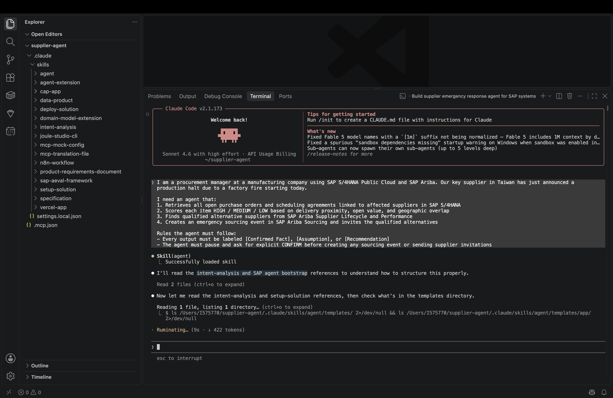
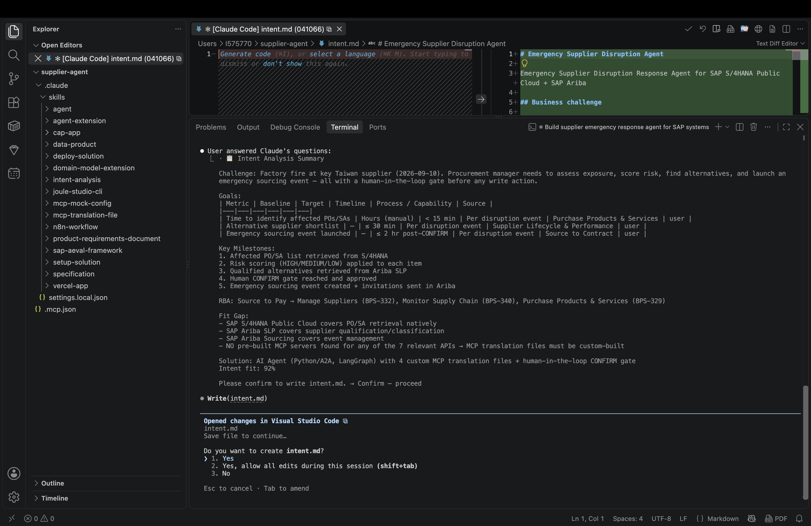
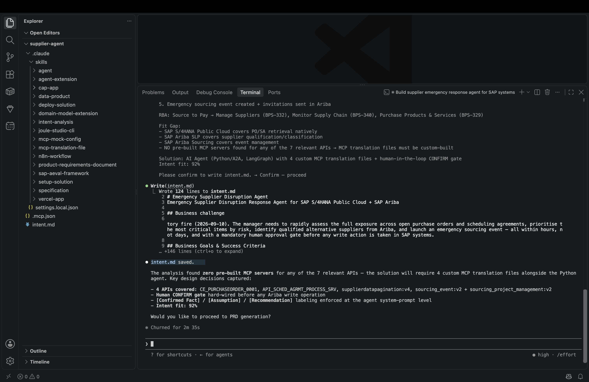
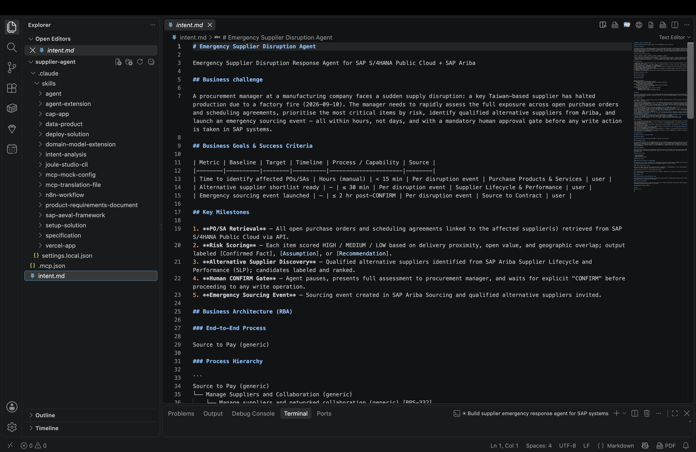

# Exercise 1 — Enter Your Intent

In this exercise you will submit your intent prompt to the IBD coding agent. The tool will analyze your intent, map it to SAP's Reference Business Architecture, and ask clarifying questions before generating the solution documents.

> [!note] Scenario recap
> You are a **Procurement Manager** responding to a supplier production halt. You need an agent that identifies at-risk purchase orders and scheduling agreements in SAP S/4HANA and scores their impact — with every output clearly labeled by data provenance. Full scenario description: [Session overview](../../README.md#scenario).

---

## Step 1.1 — Enter the Intent Prompt

In the coding agent chat, paste the following prompt and press **Enter**:

```
I am a procurement manager at a manufacturing company using SAP S/4HANA Public Cloud. Our key supplier in Taiwan has just announced a production halt due to a factory fire starting today.

I need an agent that:
1. Retrieves all open purchase orders and scheduling agreements linked to affected suppliers in SAP S/4HANA
2. Scores each item HIGH / MEDIUM / LOW based on delivery proximity, open value, and geographic overlap

Rules the agent must follow:
- Every output must be labeled [Confirmed Fact], [Assumption], or [Recommendation]
```

> [!tip] In a hurry? Add `FastTrack.` to the end of your Step 1.1 prompt to skip all questions and go straight to the result.

The IBD skill loads and begins the intent analysis pipeline.

> [!note] Every IBD run looks different — that is expected
> IBD uses an LLM to interpret your intent, so the exact wording of clarifying questions, the order of steps, and the generated document content will vary between runs and between participants. Screenshots in this guide are **illustrative only** — your session will not look identical. Focus on the checklists, not the screenshots.



---

## Step 1.2 — Answer Clarifying Questions

IBD will ask a few follow-up questions before generating the intent document. Questions vary by run — use this cheat sheet to answer quickly and confidently.

---

### Cheat sheet

**"What does success look like?"**
IBD may show a numbered list of goals — pick the ones that fit. For this scenario, good choices are:
- Cover 100% of affected purchase orders within 15 minutes
- Full risk-scored triage report ready within 30 minutes

**"Which SAP systems are involved?"**
→ `SAP S/4HANA Public Cloud` — purchase orders and scheduling agreements both come from S/4HANA.

**"What is the business process?"**
→ `Source to Pay` — specifically the supplier disruption response part: triage open POs and scheduling agreements.

**"Are there any compliance or auditability requirements?"**
→ `Yes` — every piece of information the agent presents must be labeled: `[Confirmed Fact]` for data retrieved from SAP systems, `[Assumption]` for scoring thresholds, `[Recommendation]` for suggested actions.

**"What is the urgency / timeline?"**
→ All affected POs and scheduling agreements must be triaged within 30 minutes of the disruption signal.

**"Which APIs or data sources should the agent use?"**
→ These APIs are available on this workshop tenant: `CE_PURCHASEORDER_0001` (purchase orders), `API_SCHED_AGRMT_PROCESS_SRV` (scheduling agreements), and `CE_SUPPLIERLIST_0001` (preferred supplier list). If IBD suggests any other API (business partner, sourcing supplier list, or anything else), answer: `"Only use APIs from the available list — CE_PURCHASEORDER_0001, API_SCHED_AGRMT_PROCESS_SRV, and CE_SUPPLIERLIST_0001."` All other APIs are not registered on this tenant and will fail at deployment.

---

> [!tip]
> Not sure about a question? Give a short answer and move on — you will review the full `intent.md` document before the PRD is generated, and you can ask the coding agent to adjust anything that doesn't look right.


## What is Happening Behind the Scenes

Once your intent is submitted, the IBD MCP server runs the following pipeline:

| Stage | What the tool does |
| --- | --- |
| **Parse** | Structures your intent into a machine-readable problem definition |
| **RBA Mapping** | Maps to SAP Reference Business Architecture → Source to Pay (BPS-329, BPS-340) |
| **Fit-Gap Analysis** | Queries SAP Knowledge Graph to assess which capabilities cover your intent |
| **API Discovery** | Discovers APIs from the available set: `CE_PURCHASEORDER_0001`, `API_SCHED_AGRMT_PROCESS_SRV`, `CE_SUPPLIERLIST_0001` |
| **Intent Fit Score** | Scores how closely the proposed solution matches your requirement (target: ≥ 0.7) |

> [!note] Low intent fit score?
> If the score is below 0.7, check that SAP S/4HANA Public Cloud was named explicitly and that both APIs (POs and scheduling agreements) are in your intent statement.

## Step 1.3 — Review and Save `intent.md`

When the analysis completes, IBD generates an `intent.md` file in your project folder. VS Code will prompt you to save it — click **Yes, allow all edits during this session**.



Review the intent analysis summary in the terminal — check the RBA mapping, API discovery, and intent fit score (target: ≥ 0.7):



Then open `intent.md` in the editor to read the full structured document:



---

**Next step →** [Exercise 2 — Review Intent, PRD & Specification](../ex02/README.md)
