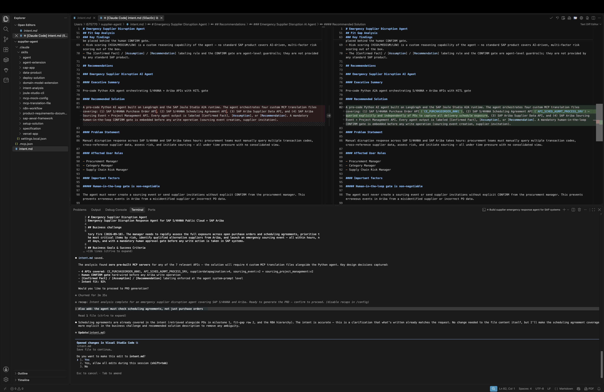
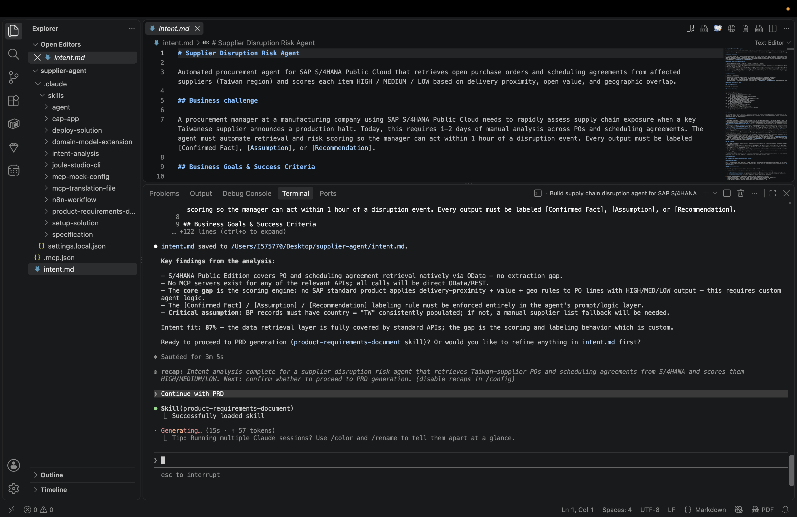
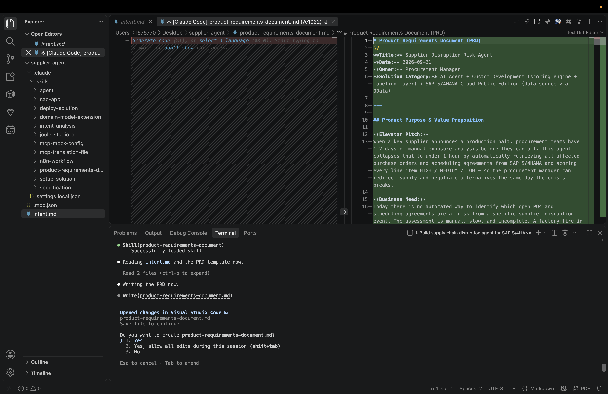
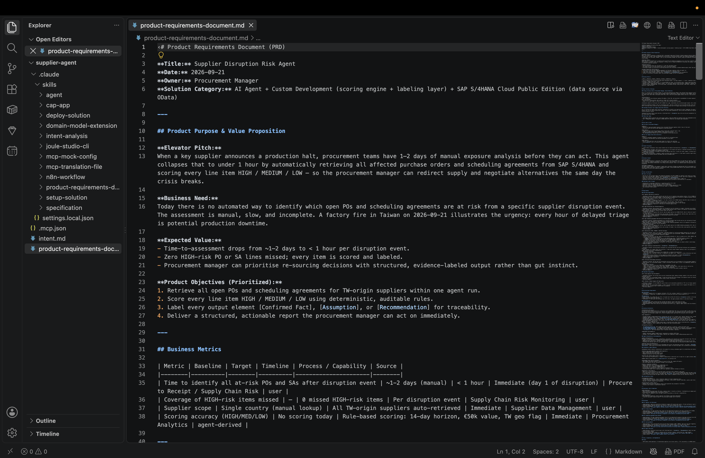
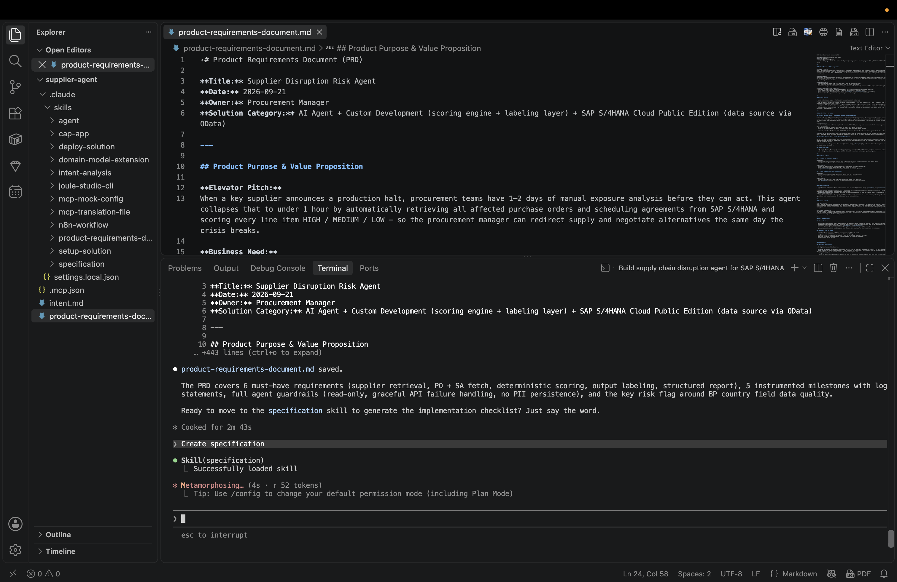
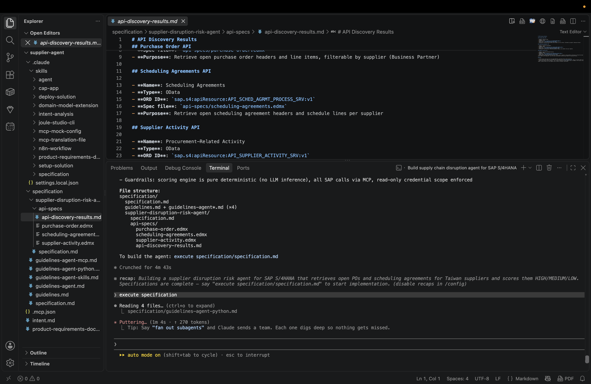
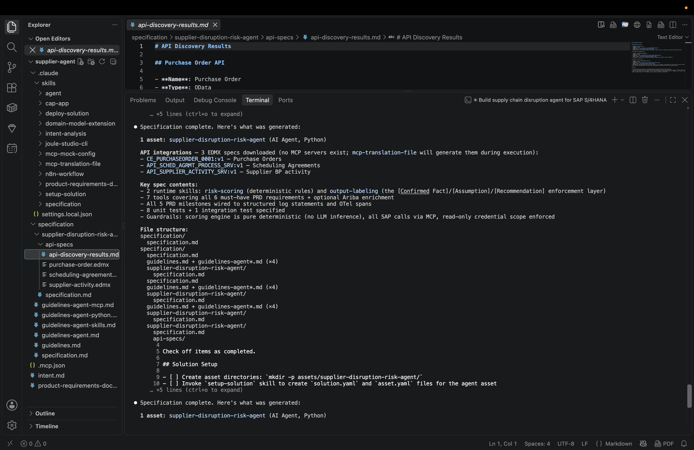

# Exercise 2 — Review Intent, PRD & Specification

In this exercise you will review the three documents IBD generates before writing any code: `intent.md`, `product-requirements-document.md`, and `specification.md`. Work through each checklist before issuing the next command.

> **Note — Your agent, your choices**
> The generated documents reflect your exact input from Exercise 1. They may differ from the examples here — that is expected and intentional. Review the intent behind each checklist item, not the exact wording.
>
> **IBD variance is normal.** The document structure, section names, and content depth vary between runs and between participants — even with the same prompt. This is IBD working as designed: it adapts to your specific intent. Use the checklists below to verify the substance is correct, not to match the screenshots exactly.

---

## Step 2.1 — Review `intent.md`

IBD generates `intent.md` automatically after the clarifying questions in Exercise 1. Open it from the VS Code Explorer panel.

**Check the following:**

- [ ] SAP Source-to-Pay is identified as the business process domain
- [ ] SAP S/4HANA Public Cloud is named as the source system
- [ ] A fit-gap analysis was conducted (existing APIs vs. agent requirements)
- [ ] A pro-code Python AI agent is the recommended solution type


Scroll through the document — it covers business goals, milestones, RBA mapping, fit-gap analysis, and recommendations:



> **💡 Refining intent**
> If something important is missing, type a correction in the coding agent before proceeding. Example:
> `"Also add: the risk score must show the scoring rationale for each line item, not just the label."`

When you are satisfied, type in the coding agent to proceed:

```
Continue with PRD
```



---

## API Availability on This Tenant

Use this table when reviewing the PRD and specification. IBD may discover APIs that are valid in the SAP API catalogue but not available on this workshop tenant — those will fail at deployment.

| API ORD ID                                            | Description                                  | Available |
| ----------------------------------------------------- | -------------------------------------------- | --------- |
| `sap.s4:apiResource:CE_PURCHASEORDER_0001:v1`         | Purchase Orders (Cloud Edition)              | ✅ Yes     |
| `sap.s4:apiResource:API_SCHED_AGRMT_PROCESS_SRV:v1`   | Scheduling Agreements                        | ❌ No      |
| `sap.s4:apiResource:CE_SUPPLIERLIST_0001:v1`          | Preferred Supplier List (Cloud Edition)      | ❌ No      |
| `sap.s4:apiResource:CE_SUPPLIERLIST_0002:v1`          | Preferred Supplier List v2                   | ❌ No      |
| `sap.s4:apiResource:OP_SUPPLIERLIST_0002:v2`          | Preferred Supplier List (On-Premise Edition) | ❌ No      |
| `sap.s4:apiResource:CE_SOURCINGSUPPLIERLIST_0001:v1`  | Sourcing Supplier List                       | ❌ No      |
| `sap.s4:apiResource:API_BUSINESS_PARTNER:v1`          | Business Partner                             | ❌ No      |
| `sap.s4:apiResource:API_PURCHASEORDER_PROCESS_SRV:v1` | Purchase Orders (On-Premise Edition)         | ❌ No      |

> **💡 Why does IBD sometimes suggest an API that isn't available here?**
> IBD discovers APIs from the SAP Knowledge Graph — a broad catalogue of what SAP systems *can* expose. It makes the best recommendation it can based on your intent, but it doesn't know which APIs are active on your specific tenant. This is a normal part of real-world development: you design against what the catalogue says is available, then validate against what your system actually exposes.
>
> For this workshop, stick to **`CE_PURCHASEORDER_0001`** — the one API all participants have access to. If IBD suggests anything else, redirect it using the guidance in Steps 2.2–2.3.
>
> If your deployed agent returns a 403 on the alternative supplier lookup, that's expected — see [TS-04](../../troubleshooting/README.md#ts-04--403-forbidden-on-alternative-supplier-lookup) for details.
>
> If your agent was generated with the On-Premise API (`API_PURCHASEORDER_PROCESS_SRV`) instead of the Cloud Edition, it will fail at runtime with an Internal Server Error — see [TS-06](../../troubleshooting/README.md#ts-06--agent-execution-error-internal-server-error) for the fix.


## Step 2.2 — Review the PRD

IBD generates `product-requirements-document.md`. VS Code will prompt you to save it — click **Yes, allow all edits during this session**.



Open it from the Explorer panel and review the full document:



**Check the following:**

- [ ] Business metrics are meaningful and match your input intent
- [ ] Personas for the use case are well defined
- [ ] Solution architecture lists exactly S/4HANA MCP servers that are available on this tenant
- [ ] All milestones are represented as named functional requirements
- [ ] The composite risk scoring model (HIGH / MEDIUM / LOW) is described as a functional requirement
- [ ] The functional requirements describe **only the operations the agent needs** — list/get on PO headers and items. If the PRD mentions create, update, or delete operations, correct it now.

> **💡 Why does the tool count matter?**
> Every tool definition is sent to the LLM with every request. An MCP server like `CE_PURCHASEORDER_0001` exposes 80+ tools covering the full OData service — read, write, delete. If the spec doesn't constrain this, the implementation will expose all of them, filling the model's context window before it can reason. The fix is to catch it here: if the PRD only describes read operations, the spec and implementation will only wire up read tools. See [TS-01](../../troubleshooting/README.md#ts-01--400-input-is-too-long-for-requested-model) for what happens when this is missed.


> **Note**
> In a real project this is where business analysts and stakeholders would review and sign off on the PRD. For this session, review the requirements above and move on.

When ready, type:

```
Create specification
```



---

## Step 2.3 — Review the Specification

IBD generates `specification.md` inside `specification/<your-agent-name>/`. Open it.

**Check the following:**

- [ ] A `specification/` folder was created
- [ ] Exactly **one** S/4HANA MCP server is listed — only `CE_PURCHASEORDER_0001`
- [ ] A `risk_scoring` logic is described
- [ ] Guidance for the agent is captured in `.md` skill files
- [ ] The spec lists **only read operations** (list/get) — no create, update, or delete. If write operations appear, tell the coding agent: `"Remove all write operations — this agent is read-only."`

> **⚠️ Unregistered API in the spec?**
> If the spec lists any API other than `CE_PURCHASEORDER_0001`, **stop here** and correct it now. Deploying with an unregistered API in `asset.yaml` will fail with a tenant configuration error in Exercise 4. Tell the coding agent: `"Remove [API name] from the specification and only use CE_PURCHASEORDER_0001."` The spec is the direct input to implementation — fixing it here is much faster than fixing it after code is generated.



When ready, type:

```
Execute specification
```

After execution, the full agent file structure is generated and the terminal confirms the spec is complete:



> **💡 MCP translation files**
> Each MCP server entry in the spec references a `translation.json`. This file maps OpenAPI/EDMX endpoints to named tools the agent can call — you will see them generated in Exercise 3.
>
> **Check the tool count before moving on.** The full `CE_PURCHASEORDER_0001` service exposes 80+ tools. Your agent only needs 4 read operations — list and get on PO headers and items. If the spec doesn't constrain this, all 80+ tools will be wired up and the agent will hit a context-window limit on every request (see [TS-01](../../troubleshooting/README.md#ts-01--400-input-is-too-long-for-requested-model)).
>
> Check the spec now — look for a `tools:` or `operations:` section under the MCP server. If it lists more than ~5 tools, or lists any write operations (create, update, delete), tell the coding agent:
> ```
> The spec has too many MCP tools. Keep only the read operations needed to list and retrieve purchase order headers and items — remove everything else.
> ```
> Fixing it here takes seconds. Fixing it after deployment means redeploy.

---


## What Happened Behind the Scenes

| Document                           | Generated by             | Purpose                                                         |
| ---------------------------------- | ------------------------ | --------------------------------------------------------------- |
| `intent.md`                        | Intent analysis pipeline | Machine-readable problem definition with fit-gap analysis       |
| `product-requirements-document.md` | PRD generator            | Functional and non-functional requirements                      |
| `specification.md`                 | Spec generator           | Implementable task list the coding agent executes in Exercise 3 |

The specification is the direct input to the implementation step — the coding agent reads it and generates all files in Exercise 3.

---

**Next step →** [Exercise 3 — Implementation & Code Review](../ex03/README.md)
