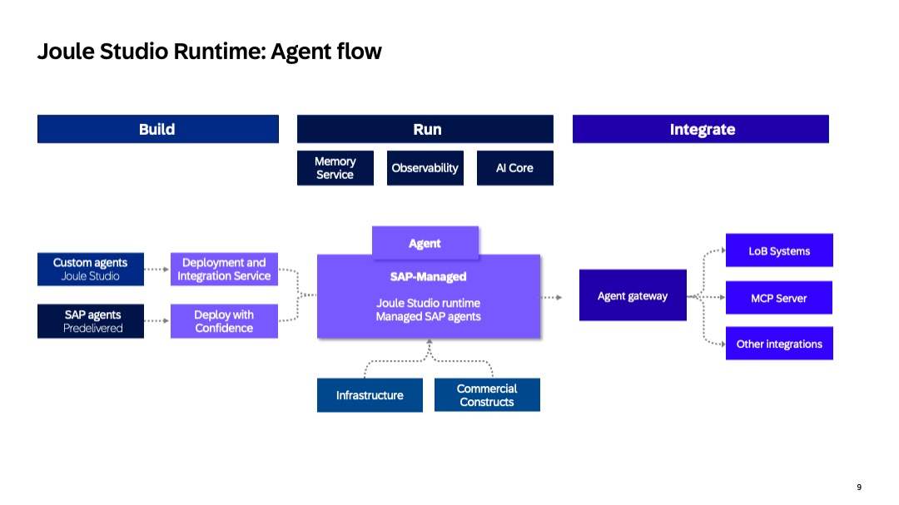
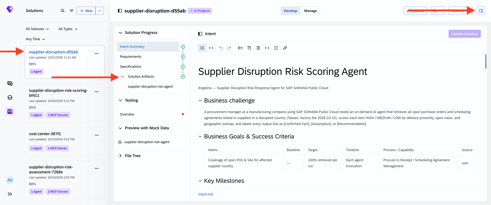
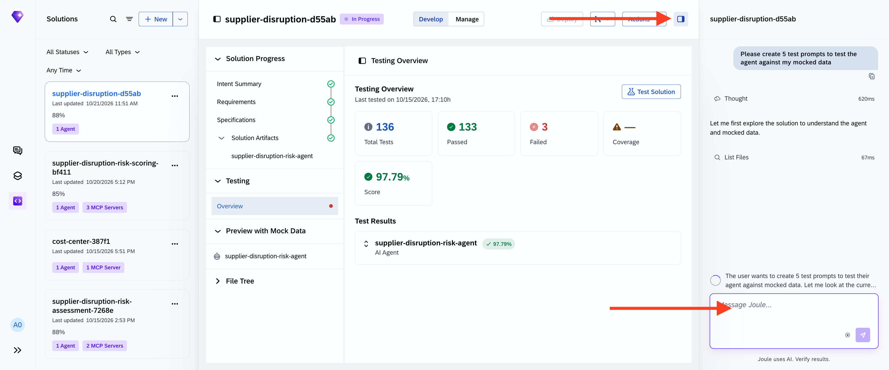
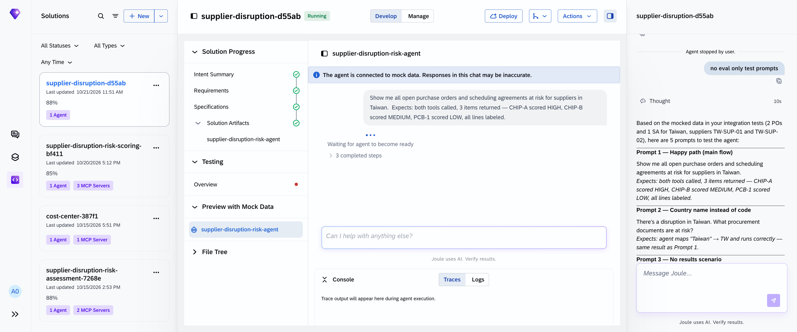
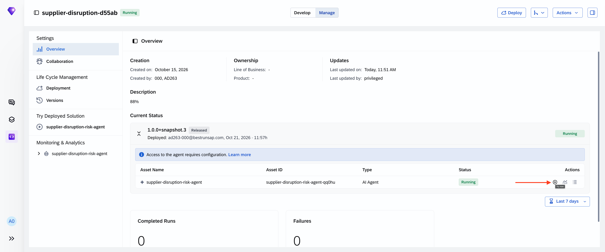
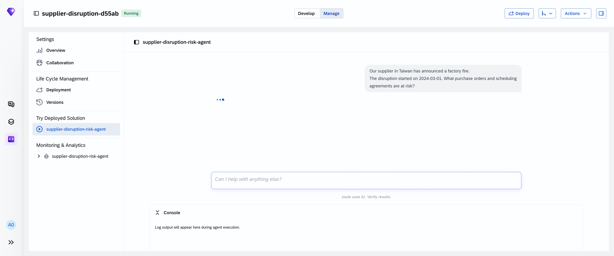

# Exercise 4 — Deploy & Test Your Agent

In this exercise you will deploy your agent to Joule Studio and run the full supplier disruption scenario via Joule Work.

---

## Step 4.1 — Validate and Deploy

Ask the coding agent to deploy:

```
deploy the agent
```

The agent is packaged and deployed to SAP managed Joule Studio runtime on the provided landscape. **Deployment includes full end-to-end integration — expect it to take several minutes.**

> **Deployment taking longer than expected?** See [TS-03 — Deployment stuck on "Integrating"](../../troubleshooting/README.md#ts-03--deployment-stuck-on-integrating)

Before packaging, `jl solution validate` runs automatically. It checks 9 rules across your solution — from confirming `solution.yaml` exists and is schema-valid, to verifying every asset folder has a proper `asset.yaml`, every file reference resolves, and every agent uses a known LLM model. Errors block the deploy; warnings are advisory. If validation fails, the output tells you exactly which rule failed and what to fix.

---

### What's happening now: Joule Studio runtime

Your agent is being deployed to Joule Studio runtime — SAP's managed execution environment for enterprise AI agents. Here's what's happening under the hood while you wait.

You build it. We run it. Joule Studio runtime provides the operational foundation to build, deploy, observe, and scale enterprise AI applications and agents, delivering trusted guardrails, integration, and extensibility. While you own the AI logic — the intent, the rules, the risk appetite, the business value — we own the runtime: from infrastructure to lifecycle to integration.

**Trusted guardrails.** Agents run in ephemeral, sandboxed containers with no persistent state or cross-tenant access, enforcing strict isolation at execution time. Agent lifecycle management — versioning, start, stop, and rollback — is handled through the runtime, ensuring every agent instance meets the same quality, security, and lifecycle standard. SAP's own agents run on this same managed runtime, discoverable and activatable through the SAP Discovery Center.

**Trusted integration.** Deployment is fully automated through a pipeline into Joule Studio runtime — no Kubernetes management, no manual infrastructure provisioning required. Out-of-the-box OpenTelemetry instrumentation delivers traces, metrics, and logs from day one, with AI actions consumption surfaced as a transparent cost metric for clear spend visibility. SAP handles provisioning, identity management, scaling, availability, and upgrades — the full operational layer.

**Trusted extensibility.** You can tailor agent behavior to your business context without touching the underlying agent code: Instruction extensions to adjust language, apply business policies, reorder results, or add clarification steps. Hooks (powered by n8n) to inject custom logic before or after agent execution: access checks, downstream system updates, approvals, or notifications — including connections to non-SAP systems via APIs and MCPs.



---

### While you wait — explore your solution in the Web UI

Open Joule Studio at [https://747391938.eu10.sapdas.cloud.sap/new/](https://747391938.eu10.sapdas.cloud.sap/new/) (credentials provided by your facilitator). Your solution will appear there as it registers — open the agent and start testing it against the mocked data. No terminal needed.



Ask the coding agent in the Web UI to generate prompts tailored to your mocked data — the sample prompts below use specific IDs that may differ in your dataset:

```
Please create 5 test prompts to test the agent against my mocked data
```



Or use the prompts below as inspiration — adapt them to the vendor IDs and agreement numbers in your own dataset:

> **No mock data?** If you used the fast-track setup, the Testing Overview may be empty and the Preview with Mock Data section may show no data. See [TS-02 — Testing Overview shows no test reports](../../troubleshooting/README.md#ts-02--testing-overview-shows-no-test-reports) — skip the prompts below and continue to Step 4.2.

**1. Full triage — the core use case**
```
Supplier TW-VENDOR-001 just had a factory fire in Taiwan. Show me all their open
scheduling agreements, score each item by risk, and find me preferred alternatives.
```

**2. Single agreement deep-dive**
```
Give me a full risk breakdown for scheduling agreement 5500000001, including the
delivery date, open quantity, and total exposure value.
```

**3. Alternative supplier check**
```
For material group L001 — Electronic Components — who are our preferred alternative
suppliers and what are their evaluation scores?
```

**4. Geographic risk filter**
```
Which of our active scheduling agreements have delivery addresses in Taiwan?
Score them and tell me which ones are HIGH risk.
```

**5. Executive summary**
```
We have a supply disruption with TW-VENDOR-001. Give me a one-page summary: how many
agreements are at risk, what's the total open value in EUR, and which alternative is
our best option based on scorecard rating?
```



---

## Step 4.2 — Run the Disruption Scenario in the Web UI

Your solution is already visible in the Joule Studio Web UI — watch its status change to **Running**. Once it does, open the agent and send the disruption scenario:

```
Our supplier in Taiwan has announced a factory fire.
The disruption started on 2024-03-01. What purchase orders and scheduling
agreements are at risk?
```



### What to look for in the response

Work through this checklist:

**M1 — Signal intake**
- [ ] Agent confirms it received the event type (factory fire), country (Taiwan), and date (2024-03-01)
- [ ] Agent states it is beginning the triage sequence

**M2 — SAP Data Retrieval**
- [ ] Open purchase orders returned for suppliers in Taiwan, each labeled `[Confirmed Fact]`
- [ ] Scheduling agreement lines returned, labeled `[Confirmed Fact]`

**M3 — Risk Scoring**
- [ ] Each line item is assigned HIGH, MEDIUM, or LOW
- [ ] Scoring rationale is shown (delivery proximity, open value, geographic overlap)
- [ ] Scoring thresholds are labeled `[Assumption]`
- [ ] Results sorted HIGH → MEDIUM → LOW

**M4 — Consolidated Risk Report**
- [ ] Risk-scored exposure summary presented with all items labeled `[Confirmed Fact]` or `[Assumption]`
- [ ] Recommended actions labeled `[Recommendation]`



> **💡 Use OTEL traces to debug**
> If the agent skips a milestone or produces unexpected output, open the **Tracing** tab in Joule Studio — each span shows which tool was called, with what inputs, and how long it took. This is the fastest way to identify instruction drift or a misconfigured tool.

> **Getting a 400 "Input is too long" error?** See [TS-01 — 400: Input is too long for requested model](../../troubleshooting/README.md#ts-01--400-input-is-too-long-for-requested-model)

---

## Step 4.3 — Optional: Try Other Interfaces

Your agent is now live and reachable from multiple surfaces. Pick one or try all three:

**Option A — A2A via CLI**

Open a new terminal tab and send the disruption scenario directly:

```bash
jl a2a message "Our supplier in Taiwan has announced a factory fire. The disruption started on 2024-03-01. What purchase orders and scheduling agreements are at risk?" --solution <your-solution-id> --asset <your-agent-name>
```

The solution ID is printed when deployment completes. The asset name matches the folder under `assets/`.

**Option B — Joule Work conversation**

Open SAP Joule Work and tag your agent by its asset ID:

```
@<your-agent-name> Our supplier in Taiwan has announced a factory fire.
The disruption started on 2024-03-01. What purchase orders and scheduling agreements are at risk?
```

> **Note — Why this matters**
> A2A is how machine-to-machine callers reach your agent — the same path an n8n workflow or another agent would use. Joule Work is the business-user surface. Testing both confirms your agent works end-to-end across all entry points.

---

## Summary

```
Taiwan factory fire signal
        ↓
M1  Disruption intake confirmed
        ↓
M2  Open POs + scheduling agreements retrieved  [Confirmed Fact]
        ↓
M3  Risk scored: HIGH / MEDIUM / LOW with rationale  [Assumption for thresholds]
        ↓
M4  Consolidated risk report presented  [Recommendation]
```

**Next step →** [Exercise 5 — Bonus Exercises](../ex05/README.md) — if you have time remaining.

Or head back to the [session overview](../../README.md).
