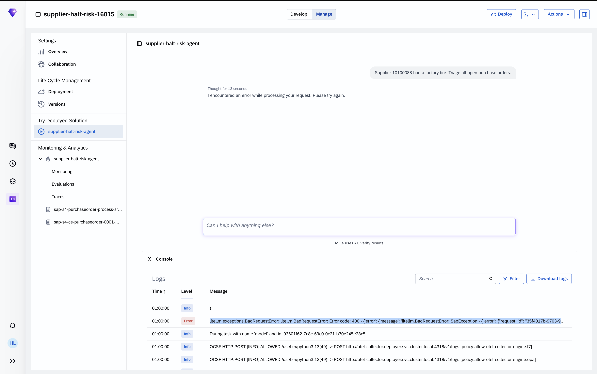
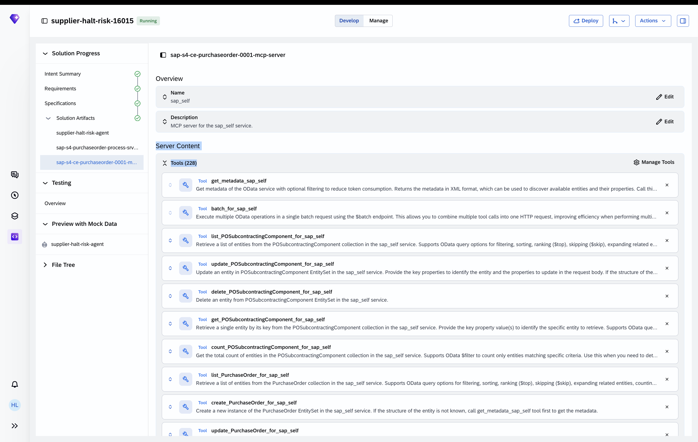
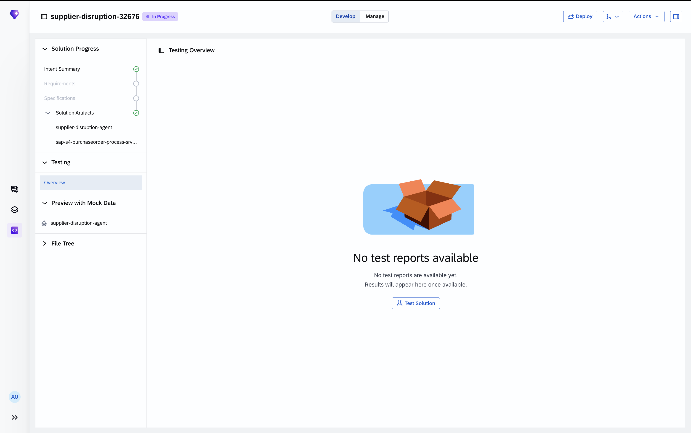
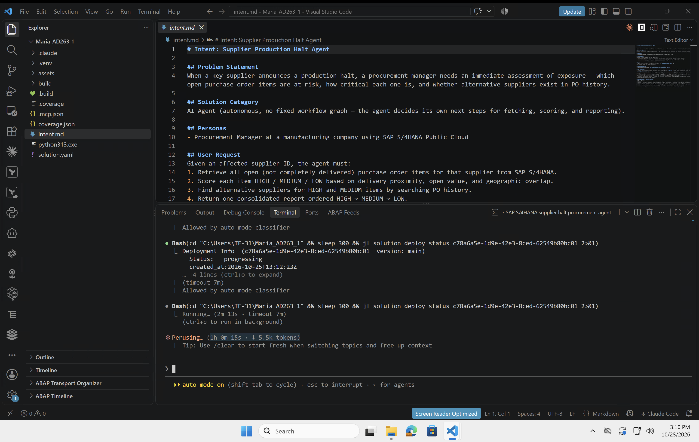
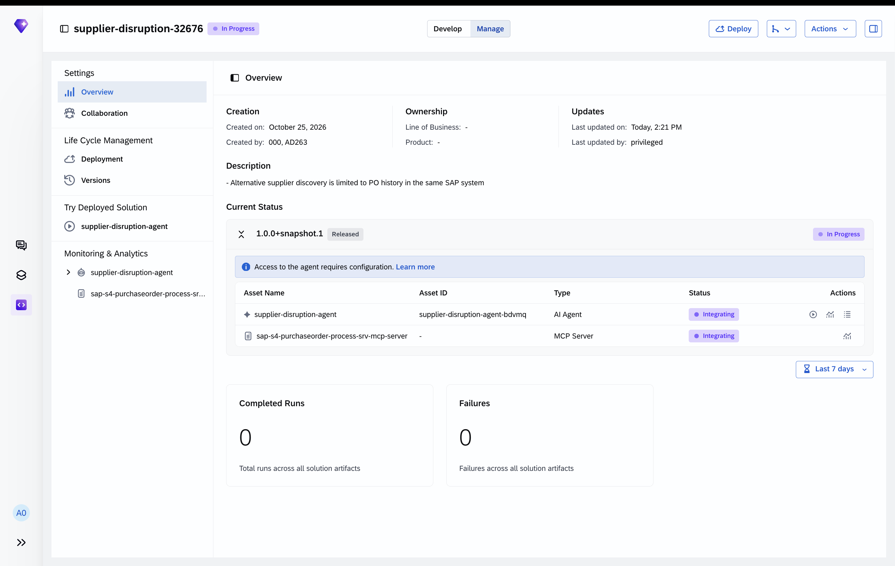
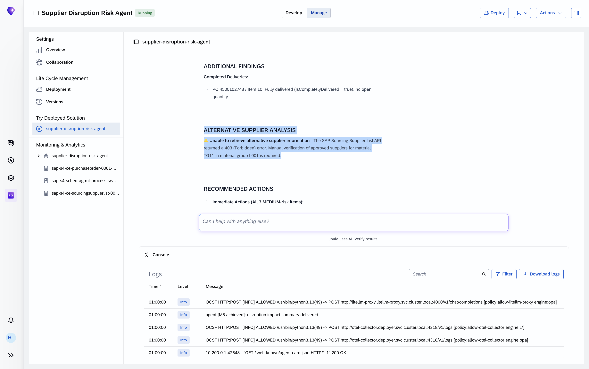
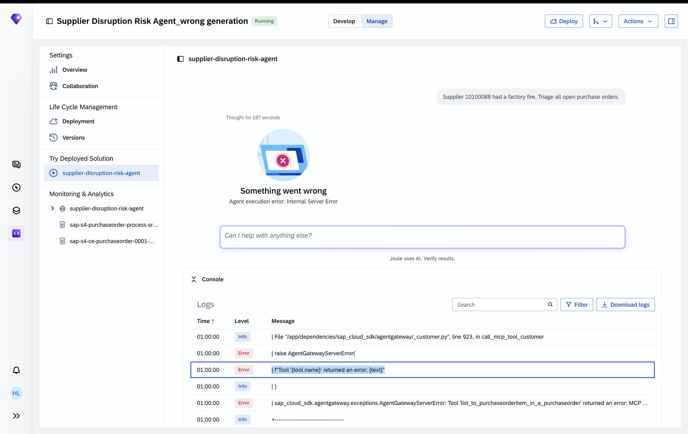

# Troubleshooting

Common issues encountered during the AD263 workshop, with root causes and fixes.

| # | Issue | Where |
|---|-------|-------|
| [TS-01](#ts-01--400-input-is-too-long-for-requested-model) | 400: Input is too long for requested model | Exercise 4 — first agent run |
| [TS-02](#ts-02--testing-overview-shows-no-test-reports) | Testing Overview shows no test reports | Exercise 3 & 4 — fast-track participants |
| [TS-03](#ts-03--deployment-stuck-on-integrating) | Deployment stuck on "Integrating" | Exercise 4 — after deploy |
| [TS-04](#ts-04--403-forbidden-on-alternative-supplier-lookup) | 403: Unable to retrieve alternative supplier information | Exercise 4 — agent response |
| [TS-05](#ts-05--agent-unavailable-on-first-joule-work-run) | Agent unavailable on first Joule Work run | Exercise 4 — Step 4.3 Option B |
| [TS-06](#ts-06--agent-execution-error-internal-server-error) | Agent execution error: Internal Server Error | Exercise 4 — first agent run |
| [TS-07](#ts-07--agent-falsely-reports-no-open-items) | Agent falsely reports "no open items" | Exercise 4 — agent response |

---

## TS-01 — 400: Input is too long for requested model

### What you see

The agent responds with a generic error in Joule Studio:

> *I encountered an error while processing your request. Please try again.*

Opening the **Console → Logs** panel shows an `Error` entry:

```
litellm.exceptions.BadRequestError: litellm.BadRequestError: Error code: 400 —
  "400 - LLM Module: Input is too long for requested model."
```



### Root cause

Your agent was generated with **all tools** from the connected MCP server — in this case 228+ tools from `sap-s4-ce-purchaseorder-0001-mcp-server` alone, totalling **302 tools** across both servers.



Every tool definition (name + description + parameter schema) is sent to the LLM as part of each request. 302 tool definitions fill the context window before the agent can even begin reasoning — the LLM rejects the request with a 400 before it processes the user message.

The fix is to keep only the tools your agent actually needs.

### Fix — send the log to the coding agent

Download the logs from Joule Studio (**Console → Logs → Download logs**) and send the file to the coding agent with this prompt:

```
I'm getting a 400 "Input is too long for requested model" error when running my agent.
Here are the logs: <attach the downloaded log file>

Please reduce the MCP tools to only the ones this agent actually needs.
```

The coding agent will read the log, identify which tools are referenced in your agent instructions, and update `asset.yaml` to include only those tools — reducing the tool list from 300+ to the handful your agent calls.

> **Why this works**
> The `asset.yaml` file controls which tools from each MCP server are exposed to your agent. By listing only the tools needed (e.g. `list_purchaseorder_for_sap_self`, `list_a_purchaseorderitem_for_api_purchaseorder_process_srv`, `get_a_purchaseorder_for_api_purchaseorder_process_srv`), the combined tool definitions fit well within the model's context window.

After the coding agent updates `asset.yaml`, redeploy:

```
deploy the agent
```

---

## TS-02 — Testing Overview shows no test reports

### What you see

The **Testing → Overview** tab in Joule Studio shows an empty state:

> *No test reports available. No test reports are available yet. Results will appear here once available.*



### Root cause

You most likely used the **fast-track setup**, which skips the automated test generation steps. Several IBD phases (Requirements, Specifications) were not completed in sequence, so no test cases were generated and no test runs were executed.

### What to do

This is expected — **continue where you are**. The absence of test reports does not block deployment or the rest of the exercise.

> **For real use cases:** When building an agent outside of a workshop, always run tests before deploying to production. Use the **Test Solution** button in the Testing Overview to trigger a test run once your agent is deployed, or ask the coding agent to generate test cases:
> ```
> Generate test cases for my agent based on the specification
> ```

---

## TS-03 — Deployment stuck on "Integrating"

### What you see

The coding agent's terminal shows deployment polling with status `progressing` — and it keeps polling:



In the Joule Studio Web UI, the solution assets show status **Integrating** for both the AI Agent and the MCP Server:



### Root cause

Integration involves registering your agent and its MCP server with the SAP backend services. During a hands-on session with many participants deploying simultaneously, this step can take anywhere from **10 minutes to 1 hour** depending on system load and the availability of backend services.

This is not an error — it is the platform working. The deployment will complete on its own.

### What to do

**During the workshop:** If integration has been running for more than 10–15 minutes, raise your hand and ask a facilitator. They can show you a working deployed solution so you can continue with the testing exercises while your deployment completes in the background.

**In real life:** Wait. Integration always completes — there is no action needed on your side. You can monitor progress in the Joule Studio Web UI under **Manage → Deployment**.

### Test against the shared reference agent while you wait

A fully deployed, working version of this agent — **`supplier-agent-north-star`** — is running on the workshop landscape. You can send it the same disruption prompt in **Joule Work** to see the expected end-to-end behaviour while your own deployment finishes.

In Joule Work, start a new conversation, type `@` followed by the reference agent's Asset ID, then send the prompt:

```
@supply-disruption-agent-nxjm8 Supplier USSU_V8003 has announced a production halt. Triage all their open purchase orders.
```

Expected result: **~30 open purchase-order items across 3 POs** (4500071516, 4500079663, 4500095072), each scored HIGH. If the reference agent returns this and yours does not once deployed, compare behaviour — and see [TS-07](#ts-07--agent-falsely-reports-no-open-items) if yours reports "no open items."

> The reference agent is shared — if it is briefly unavailable, retry in a minute. Use it to unblock the testing exercises; always validate your own agent once its deployment turns green.

---

## TS-04 — 403: Unable to retrieve alternative supplier information

### What you see

The agent completes the risk scoring but returns an error in the **Alternative Supplier Analysis** section:

> *⚠️ Unable to retrieve alternative supplier information — The SAP Sourcing Supplier List API returned a 403 (Forbidden) error. Manual verification of approved suppliers for material TG11 in material group L001 is required.*


### Root cause

Your agent attempted to call an API (such as the SAP Sourcing Supplier List) that is not accessible on this workshop tenant. The IBD specification may have included it based on the SAP Knowledge Graph catalogue, but the backend user does not have the required authorisation roles for this API.

### What to do

**During the workshop:** This is expected on the shared workshop tenant — not all APIs are authorised for all users. The agent still completes the PO triage and risk scoring correctly. The alternative supplier section will show "no data available" or a 403 message — this does not break the exercise. Continue to the next step.

**In real life:** Work with your S/4HANA administrator to assign the correct authorisation roles for the API. Alternatively, remove the API from `asset.yaml` and update the agent instructions to handle the missing data gracefully (e.g. always return "No alternative supplier found in PO history" when the API is unavailable).

---

## TS-05 — Agent unavailable on first Joule Work run

### What you see

You open Joule Work, tag your agent with `@your-asset-id`, and send the disruption prompt — but instead of a response from your agent, Joule Work replies:

> *It looks like you've addressed @your-agent-name, but this agent isn't currently available or configured in my environment.*



### Root cause

Even after your agent status shows **Running** in Joule Studio, the first request in a new Joule Work session may fail because the agent's registration hasn't fully propagated to the Joule Work routing layer yet. This is a session cache issue — it resolves on re-login.

### Fix

Log out of Joule Work completely, then log back in. After a fresh login, tag the agent again with `@your-asset-id` — the agent will be available and respond correctly.

---

## TS-06 — Agent execution error: Internal Server Error

### What you see

The agent thinks for a long time (often 100+ seconds), then returns:

> *Something went wrong*
> *Agent execution error: Internal Server Error*



Opening **Console → Logs** shows an error like:

```
sap_cloud_sdk.agentgateway._customer: Tool 'list_a_purchaseorderitem_for_api_purchaseorder_process_srv'
returned an error: MCP Builder destination request failed. Status code: 400.
Response: {"error": {"message": {"value": "Property Supplier not found in type A_PurchaseOrderItemType"}}}
```

### Root cause

Your agent was generated using the **On-Premise Purchase Order API** (`API_PURCHASEORDER_PROCESS_SRV`) instead of the **Cloud Edition** (`CE_PURCHASEORDER_0001`). The On-Premise API's data model does not have a `Supplier` field on purchase order items — so every query fails with a 400, which the runtime surfaces as an Internal Server Error.

This typically happens when IBD picks a different API than expected during specification. See [Exercise 2 — API Availability on This Tenant](../exercises/ex02/README.md#api-availability-on-this-tenant) for the full list of which APIs are available.

### Fix — send the logs to the coding agent

Download the logs (**Console → Logs → Download logs**) and send the file to the coding agent:

```
My agent is failing with an Internal Server Error.
Here are the logs: <attach the downloaded log file>

Please fix the agent to use only CE_PURCHASEORDER_0001 — the On-Premise API is not available on this tenant.
```

The coding agent will identify the wrong API in `asset.yaml`, swap it for `CE_PURCHASEORDER_0001`, and update the agent instructions to use the correct tool names. After the fix, redeploy:

```
deploy the agent
```

---

## TS-07 — Agent falsely reports "no open items"

### What you see

You run the disruption prompt for a supplier that genuinely has open purchase orders (e.g. `USSU_V8003`), but the agent confidently replies that there is nothing to triage:

> *All purchase order items for supplier USSU_V8003 have been completely delivered. There are no open items — no supply disruption risk.*

The deployment is green and no error appears in the logs — the agent just reaches the wrong conclusion.

### Root cause

The agent is discovering open items the **slow way**: it lists *all* of the supplier's purchase order headers first, then tries to fetch the items for each. In this system a single supplier can have **thousands** of historical purchase orders (e.g. `USSU_V8003` has well over 5,000). The full list is too large, so the agent's response gets truncated after the first page — which happens to contain only older, fully-delivered orders. Seeing nothing open in that first slice, it wrongly concludes the supplier has no open items.

Unlike [TS-06](#ts-06--agent-execution-error-internal-server-error), this is **not** an error or a wrong-API problem — the query succeeds, it just looks at the wrong subset of data. That is what makes it easy to miss.

### Fix — send this to the coding agent

```
My agent reports no open items for a supplier that definitely has open POs.
Change it so it retrieves open purchase-order items directly and filters by
supplier, instead of listing all the supplier's purchase orders first — some
suppliers have thousands of POs and the full list gets truncated. "Open" means
the item is not completely delivered.
```

After the coding agent updates the retrieval logic, redeploy:

```
deploy the agent
```

### Verify the fix

Re-run the disruption prompt. As a sanity check, `USSU_V8003` should now return roughly **30 open items across 3 purchase orders** (4500071516, 4500079663, 4500095072). If you still get "none," the agent is still enumerating headers — re-apply the fix above.

> **Why this works**
> "Open" is a property of the purchase order *item* (whether it has been completely delivered), not something you find by scanning every header. Filtering items directly for the supplier returns only the handful of still-open lines, no matter how large the supplier's total order history is.
